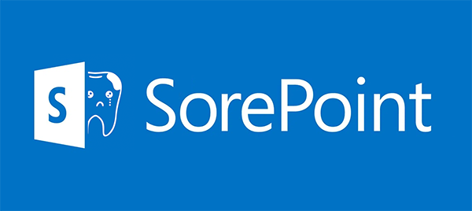

# SharePoint Mangling & Raw Grievance

## Megjegyzések

"Felhasználó nincs hitelesítve" üzenet azt jelezheti hogy az autentikációhoz szükséges hálózati profil/biztonsági policy újraindításra vár. Windows újraindítás segíthet.

Összeolvasásor a program kizárólag az összeolvasás dátumát tartalmazó fájlneveket veszi figyelembe.

Archiváláskor minden fájl átmozgatásra kerül aminek a dátuma nem "Következő napi dátum". Ha egy azonos nevű fájl már létezik az archív mappában, akkor felülírásra kerül.

Az előbbiekből következik hogy korábbi dátumú kallódó fájlok (amelyek valamiért a SharePoint TK mappában maradtak) nem fognak bekerülni későbbi dátumú összeolvasásba, viszont a következő fájlcserekor archiválódnak.

A sablon engedélyei nem lehetnek egyediek, különben a TK-s ügyintézők nem fogják látni a napi fájlokat.

## Letöltés

[legutóbbi verzió](https://github.com/csd79/smrg/releases/latest)

## TODO

* Add method to read the files' last modification date.
  * If we leave the program running, it could check for changes every 10 minutes, and display a notification with the number of changed files.
  * It'd be nice if the sumarized file would show which row was created last.
* GUI fields should be file/directory selectors, whenever it makes sense.
  * When selecting location in the SP document library, suggest connecting it if it is not connected.
* New input field: long term repo spreadsheet.
  * After every summary, new rows could be added to this file if the user chooses so.
  * When doing multiple summaries during the day, only the last one (hopefully containing every report) should be stored in this file.
  * Should be invisible to observers.
